# TraceGuard

**Live, audit-ready traceability for regulated software: TraceGuard turns your existing Jira, Confluence and Bitbucket work into a traceability matrix, and stops untraced changes to safety-critical code before they merge.**

  

[▶ Demo video](https://www.youtube.com/watch?v=Fb5IItTanxs) · [Devpost submission](https://devpost.com/software/traceguard-3rkv6g) · [Try it](#try-it) · [Architecture](#architecture)

[](https://www.youtube.com/watch?v=Fb5IItTanxs)

## Contents

- [Why](#why)
- [Features by surface](#features-by-surface)
- [Gallery](#gallery)
- [Architecture](#architecture)
- [Flows](#flows)
- [Try it](#try-it)
- [Jira data model](#jira-data-model)
- [Bitbucket merge check](#bitbucket-merge-check-bitbucket-app)
- [Layout](#layout)
- [Build from source (developers)](#build-from-source-developers)
- [License](#license)

## Why

Teams that build medical, automotive or industrial software must prove, for every release, that each requirement is implemented, verified by a passing test and linked to the hazards it controls (IEC 62304, ISO 26262, ISO 13485). In practice that proof is a spreadsheet rebuilt by hand before each audit. It is out of date the day after it is finished, and nobody notices when a developer changes dosing code without a ticket until an auditor does.

TraceGuard keeps the trace where the work already happens and checks it continuously:

**Requirement → Hazard → Story → Pull request → Test**

It detects six gap types per release (fix version): G1 requirement not implemented, G2 not verified, G3 failed test, G4 untraced change to safety-critical code, G5 verification older than the last change, G6 requirement edited after approval. Data is read as the app, but before showing live data the Jira, Confluence, Rovo and MCP surfaces check that the calling user has Browse projects permission in the Jira project, and writes (linking a test, creating a task, publishing an evidence pack) also check the user's own Jira or Confluence space permissions. The Bitbucket merge check is authenticated by a signed request from the Bitbucket app, not by the user.

TraceGuard reports evidence; it does not certify compliance.

## Features by surface

TraceGuard is two Forge apps that share one TypeScript core (`src/core`): **TraceGuard for Jira + Confluence** and **TraceGuard for Bitbucket**.

| Surface | What it does |
| --- | --- |
| **Jira project page** "TraceGuard" | Coverage score per release, traceability matrix, gaps sorted by severity, change-impact checker, *Publish evidence pack*. |
| **Jira issue panel** "Trace chain" | Full requirement chain of the open issue, with a one-click *Link test case* fix for missing verification (G2). |
| **Jira admin page** "TraceGuard setup" | *Load demo data*, safety-critical paths, *Connect Bitbucket*, *Connect a coding agent* (MCP server URL). |
| **Confluence** | Macro *Traceability matrix* for quality documents; evidence packs published as dated Confluence pages (summary, open gaps, matrix). |
| **Bitbucket** merge check | *TraceGuard trace check* fails a pull request that changes safety-critical code without a Jira issue traced to every affected requirement, and names the requirement, hazard, issue to reference and tests to re-run. |
| **Rovo** Audit Prep Agent | Rovo agent with four actions (`list_gaps`, `get_trace`, `generate_evidence_pack`, `assign_gap`); `assign_gap` creates a real Jira task. Writes ask for confirmation first. The app defines six Forge action modules in total, five exposed over MCP. |
| **MCP** (`rovo:mcp`) | Five tools for a coding agent in any MCP client: `check_change_impact`, `find_requirements_for_path`, `get_trace`, `list_gaps`, `generate_evidence_pack`. The agent can ask which requirements and tests a file affects before it edits it. |

With the CardioSense demo data, release 2.3 starts at **38% coverage with 6 gaps**; linking test case CSM-27 to CSM-7 from the issue panel raises it to **50% with 5 gaps**. A change to `src/dosing/limits.ts` maps to **REQ-112** "Enforce maximum dose limit" (class C, hazard HAZ-07), story CSM-16 and tests CSM-23/CSM-24.

## Gallery

All screenshots are taken from the deployed apps on a live Atlassian site with the demo data loaded.

<table>
  <tr>
    <td width="50%">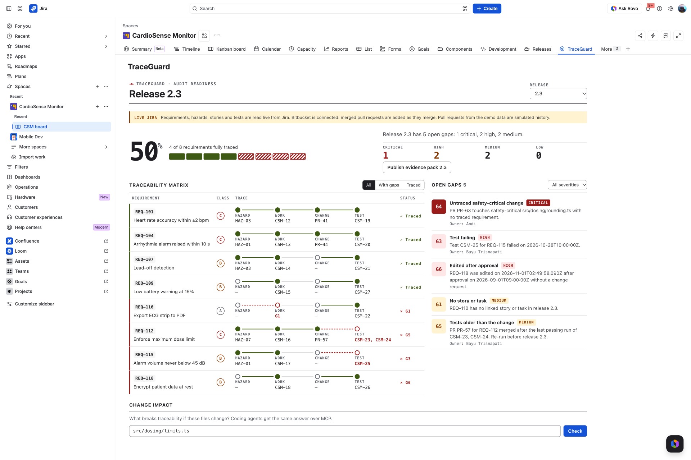<br><sub><b>Jira project page.</b> Release 2.3 matrix read from Jira issues: 50% coverage, 5 open gaps.</sub></td>
    <td width="50%">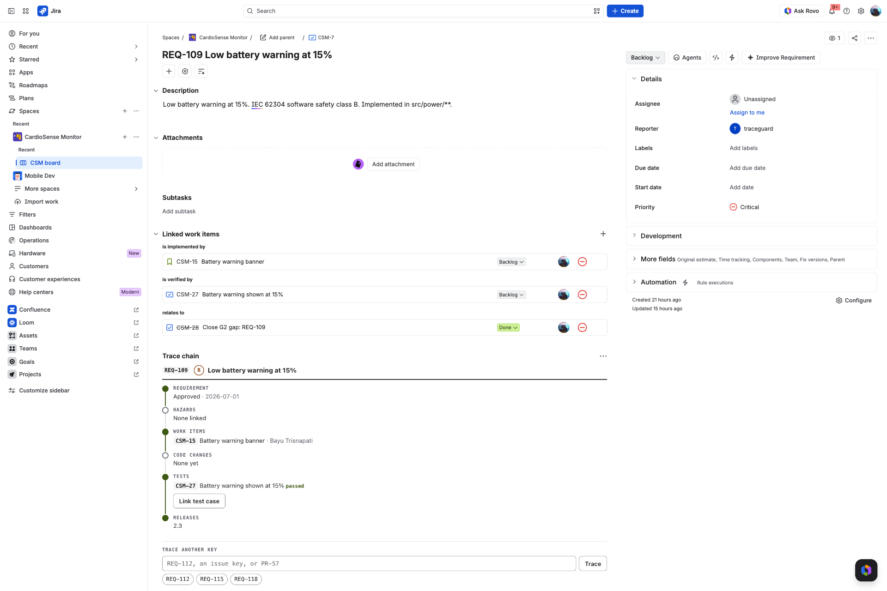<br><sub><b>Issue panel.</b> Trace chain of CSM-7 (REQ-109): approval, hazards, work item CSM-15, code changes and the verifying test CSM-27, with the <i>Link test case</i> quick fix.</sub></td>
  </tr>
  <tr>
    <td>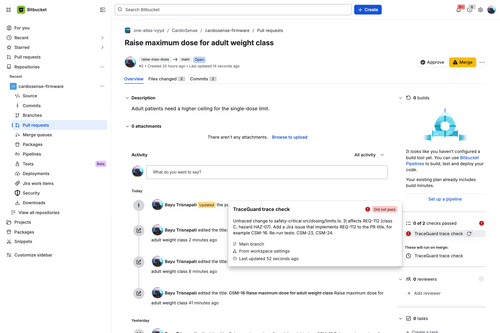<br><sub><b>Bitbucket merge check.</b> An untraced change to <code>src/dosing/limits.ts</code> fails and names REQ-112, HAZ-07, CSM-16 and the tests to re-run.</sub></td>
    <td>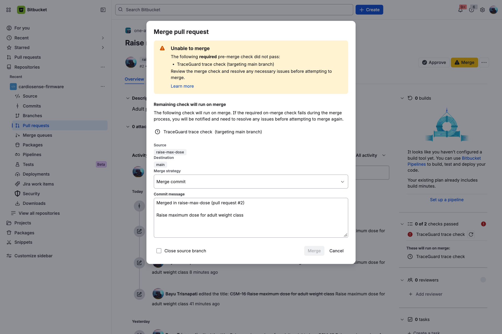<br><sub><b>Merge blocked.</b> With the check marked Required, Bitbucket refuses the merge.</sub></td>
  </tr>
  <tr>
    <td>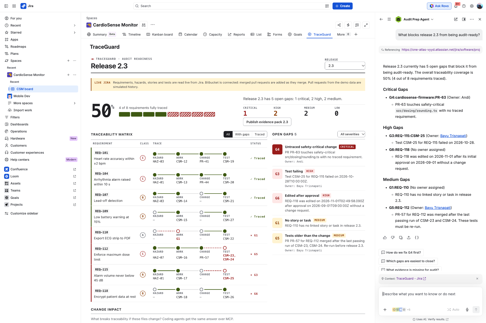<br><sub><b>Rovo Audit Prep Agent.</b> Answers what blocks release 2.3, grouping open gaps by severity and owner.</sub></td>
    <td>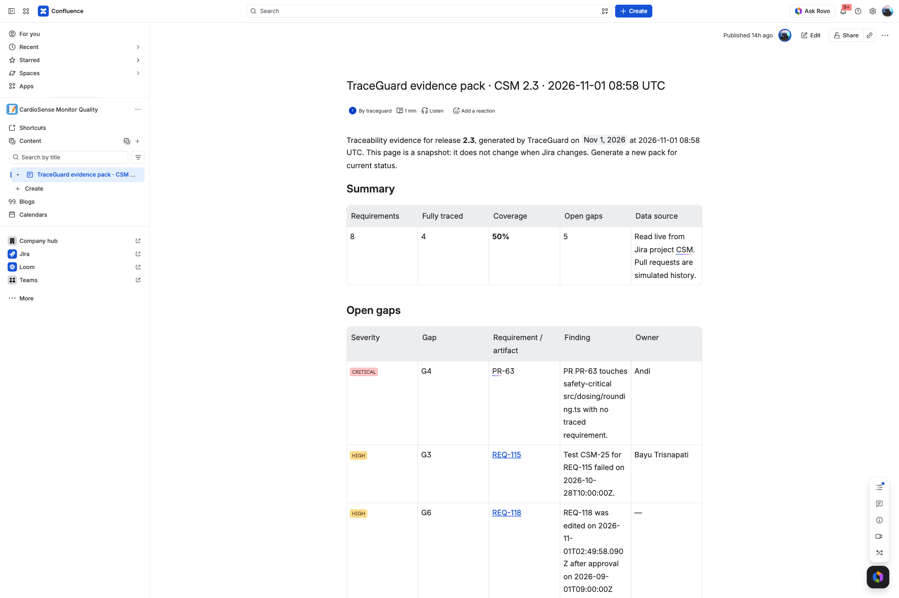<br><sub><b>Confluence evidence pack.</b> A dated snapshot of release 2.3 with summary (50% coverage, 5 open gaps) and the open gaps for auditors.</sub></td>
  </tr>
  <tr>
    <td>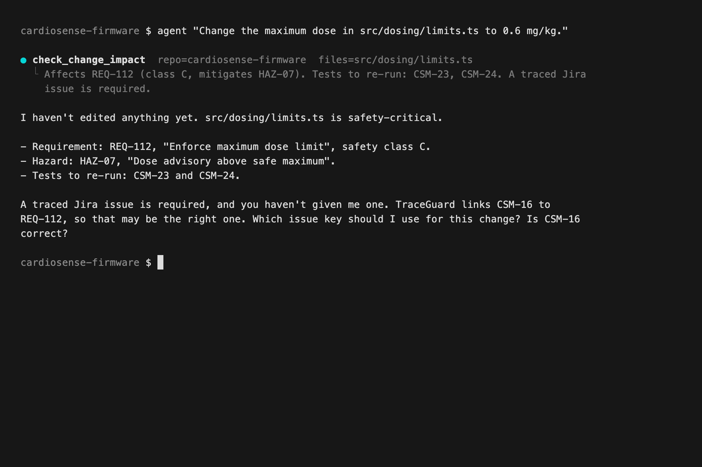<br><sub><b>MCP tools.</b> A coding agent checks change impact and asks for the Jira issue before editing safety-critical code.</sub></td>
    <td>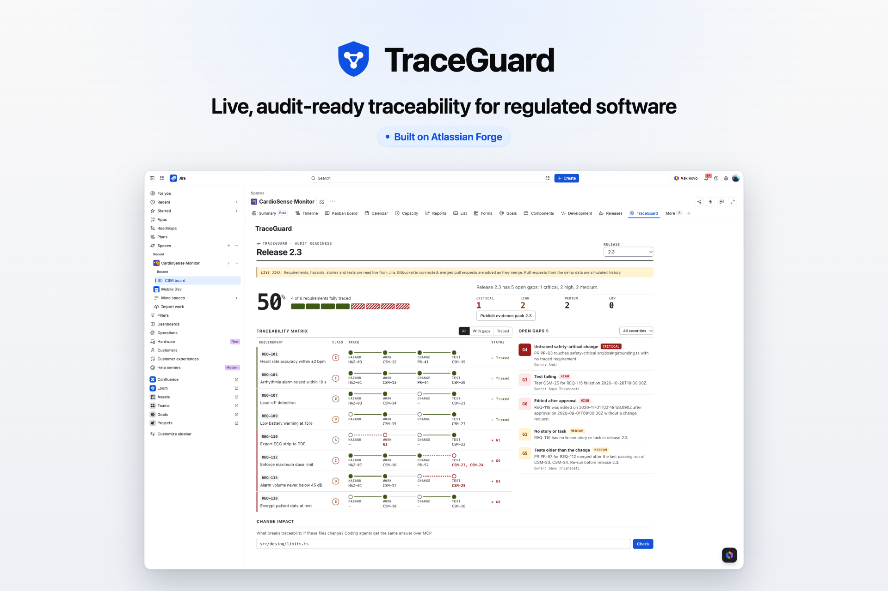<br><sub><b>TraceGuard.</b> Jira, Confluence, Bitbucket, Rovo and MCP on one trace.</sub></td>
  </tr>
</table>

## Architecture

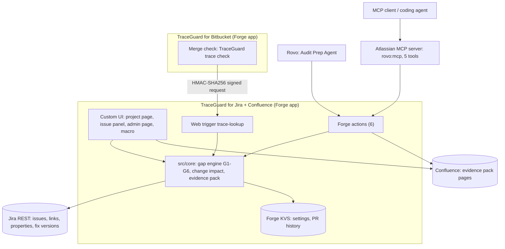

The same picture as a static diagram: [`docs/architecture.svg`](docs/architecture.svg).

## Flows

**Pull request to merge decision**

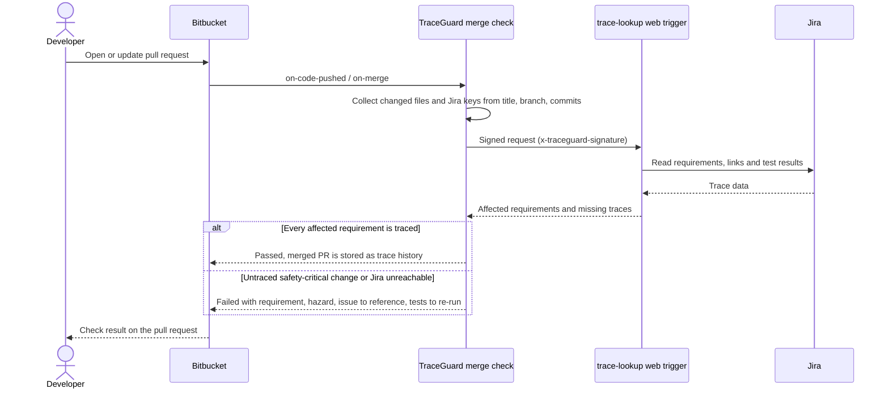

**Judge walkthrough**

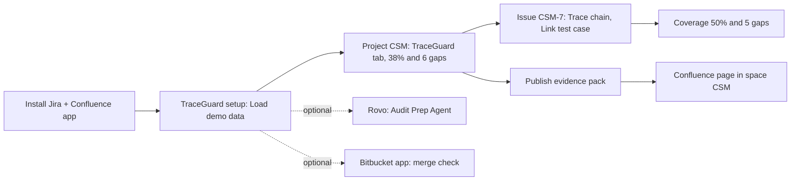

## Try it

Nothing to build; the install links below use the deployed apps.

1. Make sure the site has **Jira and Confluence** before you open the install link. Without Confluence the Confluence part of the install fails; add Confluence and open the link again.
2. Install [TraceGuard for Jira + Confluence](https://developer.atlassian.com/console/install/d762877f-0818-47f7-9ed7-a02c246bd78e?signature=AYABeOtB%2Fd4vb41GJqgj5TsECSkAAAADAAdhd3Mta21zAEthcm46YXdzOmttczp1cy13ZXN0LTI6NzA5NTg3ODM1MjQzOmtleS83MDVlZDY3MC1mNTdjLTQxYjUtOWY5Yi1lM2YyZGNjMTQ2ZTcAuAECAQB4CxqLTo9l4lqXuFjNim1xJM%2Bp%2F3TVP9xHS2BrU5DRRucBdTOOJrGMYM0TyDpYaVtkMQAAAH4wfAYJKoZIhvcNAQcGoG8wbQIBADBoBgkqhkiG9w0BBwEwHgYJYIZIAWUDBAEuMBEEDJeGhPhXXOynh1w4awIBEIA7FS0ErZoWPb%2BcB3nsd3lXcqPYCXYyjieG13lZxacGSaGPTf7wX1GtY4BYvkCmVqNZ0AITg6r5OEh5O3sAB2F3cy1rbXMAS2Fybjphd3M6a21zOmV1LXdlc3QtMTo3MDk1ODc4MzUyNDM6a2V5LzQ2MzBjZTZiLTAwYzMtNGRlMi04NzdiLTYyN2UyMDYwZTVjYwC4AQICAHi9bVMAkme4qVQX1fQHo6ePw3H40A7cGfz7yrmSfBWMXgGhlQ%2BQpLvrbwg6o9wiwxy4AAAAfjB8BgkqhkiG9w0BBwagbzBtAgEAMGgGCSqGSIb3DQEHATAeBglghkgBZQMEAS4wEQQM7rtcT5hxjk%2FmHsmqAgEQgDsHOg0fDoyati4qJV5fxMSSRzeDz5ydVIoc9o0tfpWIfRHYccJS5B7JTxFlrcaPLX2wnq69GzdKv3O4IAAHYXdzLWttcwBLYXJuOmF3czprbXM6dXMtZWFzdC0xOjcwOTU4NzgzNTI0MzprZXkvNmMxMjBiYTAtNGNkNS00OTg1LWI4MmUtNDBhMDQ5NTJjYzU3ALgBAgIAeDYASx0XCjkny4iLV6vz%2BKtEGSGT6kdt0QRpkn6D%2FlVEARbthSDfFWSd5M6gB84wWV0AAAB%2BMHwGCSqGSIb3DQEHBqBvMG0CAQAwaAYJKoZIhvcNAQcBMB4GCWCGSAFlAwQBLjARBAwTipJ5ZvfyYJ0RrEsCARCAO1q2qqKJzytFg8Jx1%2BgIF08QVo2FaRHXR%2FQn3ElSScgKXUNYm3snvpM3gWeJCYb%2FMdERJmXxl0cg9pZiAgAAAAAMAAAQAAAAAAAAAAAAAAAAABOh5B5GwTWiyQ4rTv%2BnUGP%2F%2F%2F%2F%2FAAAAAQAAAAAAAAAAAAAAAQAAADLLNOnyjihA47Y59Rx9WiqGIc8O1w1r0eL8VKilN3Ae0NGt1kexsJgkIFJzqZMtG9KO8KVzB9Pvl0w8UHXJ3eEmXtU%3D&product=jira&product=confluence) on your site and choose both Jira and Confluence (Confluence enables evidence packs).
3. Jira → ⚙ Settings → **Marketplace apps** → **TraceGuard setup** (left menu) → **Load demo data** (Jira admin only, about 20 seconds). It creates project `CSM` and the Confluence space `CSM`. If Confluence was added after the demo was loaded, the same page shows **Create Confluence space**; click it before publishing an evidence pack.
4. Open project **CSM** → tab **TraceGuard**. If the tab is not visible, it is under **More** (e.g. "2 more tabs"). Release 2.3 shows 38% coverage with 6 gaps; **Publish evidence pack** writes a page to Confluence space `CSM`.
5. Open issue **CSM-7** → **View app actions** (toolbar) → **Trace chain** to see the issue's requirement chain and its gaps.
6. Rovo: open Rovo chat, pick **Audit Prep Agent**, ask "What blocks release 2.3 from being audit-ready?". Rovo must be activated by a site admin and is not available on every site (new trial sites often lack it). Without Rovo, the same gaps and evidence pack are on the project page (step 4), in the Confluence macro *Traceability matrix*, and through the MCP tools (setup page → *Connect a coding agent*).
7. Optional, for the merge check: install [TraceGuard for Bitbucket](https://developer.atlassian.com/console/install/346c4e15-82c1-453c-babc-216f7b5aa73c?signature=AYABeIdEkXvwLP5Kd%2B49rk%2F3Vf4AAAADAAdhd3Mta21zAEthcm46YXdzOmttczp1cy13ZXN0LTI6NzA5NTg3ODM1MjQzOmtleS83MDVlZDY3MC1mNTdjLTQxYjUtOWY5Yi1lM2YyZGNjMTQ2ZTcAuAECAQB4CxqLTo9l4lqXuFjNim1xJM%2Bp%2F3TVP9xHS2BrU5DRRucB9wl8gDPDKKaeQcSgyXbOVwAAAH4wfAYJKoZIhvcNAQcGoG8wbQIBADBoBgkqhkiG9w0BBwEwHgYJYIZIAWUDBAEuMBEEDJT7aiRp2AyBO7qMGQIBEIA79mPpGGQRlnQR2YDf%2Fg1u0TaoktBL%2B8JCDb6jPxut335kmSp6aIEun31f2w5Wr3G6AGr3N2Ac%2F5CshWMAB2F3cy1rbXMAS2Fybjphd3M6a21zOmV1LXdlc3QtMTo3MDk1ODc4MzUyNDM6a2V5LzQ2MzBjZTZiLTAwYzMtNGRlMi04NzdiLTYyN2UyMDYwZTVjYwC4AQICAHi9bVMAkme4qVQX1fQHo6ePw3H40A7cGfz7yrmSfBWMXgFxx24oc%2B%2F9%2B5ihXqqXLrHNAAAAfjB8BgkqhkiG9w0BBwagbzBtAgEAMGgGCSqGSIb3DQEHATAeBglghkgBZQMEAS4wEQQMMyy6W%2BALDfDNgt1rAgEQgDseGnIbQyMcUsyU4R9YUxtXqi0Hz7Nmnf3xUZhbCMJmDgbImlzFcrZD36JkDjUOYZyO1FNG1BZy%2B4NdagAHYXdzLWttcwBLYXJuOmF3czprbXM6dXMtZWFzdC0xOjcwOTU4NzgzNTI0MzprZXkvNmMxMjBiYTAtNGNkNS00OTg1LWI4MmUtNDBhMDQ5NTJjYzU3ALgBAgIAeDYASx0XCjkny4iLV6vz%2BKtEGSGT6kdt0QRpkn6D%2FlVEAXnEggvsRCt4yX0N1bIXsqgAAAB%2BMHwGCSqGSIb3DQEHBqBvMG0CAQAwaAYJKoZIhvcNAQcBMB4GCWCGSAFlAwQBLjARBAxRGzcL%2FBdwT5%2Fh7AoCARCAO5RPgSktLqKt%2BdStoCCijo0hO2X0OrKo%2FSqVgM%2BVlo0A%2F32BhXaF4IVVT8mhOKMjBJhZIZ0ruQc9mP3nAgAAAAAMAAAQAAAAAAAAAAAAAAAAAFFqmcakjuiOPxPPjrTMBPH%2F%2F%2F%2F%2FAAAAAQAAAAAAAAAAAAAAAQAAADKRmD1B3%2Frfb%2ByQ0sNKvLpCrIO91uV%2Fm76qckb5tUb8qmO3JCpYHbIWVAk8pfdbg444PFYqeUCMrPkjlQT5SzFEnis%3D&product=bitbucket) in a Bitbucket workspace and follow *Connect* below.

## Jira data model

TraceGuard reads traceability live from the Jira project `CSM`. Until that project exists, every surface falls back to the fictional CardioSense sample in `src/demo/cardiosense.ts` and responses carry `"simulated": true`.

| Concept | In Jira |
| --- | --- |
| Requirement | Issue type `Requirement`; issue property `traceguard` = `{ reqId, safetyClass, status, approvedAt, paths }` |
| Hazard | Issue type `Hazard`; property `{ hazardId, severity }`; link `Mitigates` from the requirement |
| Work item | Any other issue linked with `Implements` to a requirement |
| Test case | Issue type `Test Case`; property `{ lastRun: { result, at, build } }`; link `Verifies` |
| Release | Fix version (released = signed off) |
| Edited after approval (G6) | Summary/description change in the changelog after `approvedAt` |
| Pull requests | Forge KVS: simulated seed history plus merged PRs reported by the Bitbucket app |

**Load demo data** (Jira settings → Marketplace apps → TraceGuard setup) creates all of the above as project `CSM`, plus a Confluence space `CSM` when Confluence is installed.

**Evidence pack**: `generate_evidence_pack` (Rovo/MCP) or *Publish evidence pack* on the project page creates a new Confluence page per run (summary, open gaps, matrix). Target space: `space` input → setting → space whose key equals the Jira project key → first global space.

## Bitbucket merge check (`bitbucket-app/`)

A second Forge app, **TraceGuard for Bitbucket**, adds the merge check *TraceGuard trace check* (`on-code-pushed`, `on-merge`). For each pull request it collects changed files and Jira issue keys (title, source branch, commits) and asks this app's `trace-lookup` web trigger, signed with HMAC-SHA256 (`x-traceguard-signature: t=<unix>,v1=<hex>`). A change to safety-critical code passes only when a referenced issue traces to every affected requirement. The check fails closed when Jira cannot be reached. Merged PRs that pass are stored as real trace history.

Connect:

1. Jira: Settings → Marketplace apps → TraceGuard setup → **Connect Bitbucket** → *Create connection*. Copy the URL and the secret (shown once).
2. Bitbucket: install the app, Workspace settings → **TraceGuard**, paste both values (workspace admin only; a signed test request is sent before saving).
3. Repository settings → Merge checks: add *TraceGuard trace check* for the main branch. Marking it Required (and adding it at workspace level) needs Bitbucket Premium; on other plans the check still runs and shows its result on every pull request.

Optional `.traceguard.yml` on the destination branch:

```yaml
repo: cardiosense-firmware   # name in TraceGuard (default: Bitbucket slug)
safety-critical:             # overrides the globs set in Jira
  - src/dosing/**
  - src/alarms/**
```

## Layout

| Path | Contents |
| --- | --- |
| `src/core/` | Gap engine G1–G6, change impact, trace chain, evidence pack (pure, no Forge imports) |
| `src/adapters/` | Jira REST reader (`jira.ts`, `jira-map.ts`), demo seed (`seed.ts`), KVS settings (`store.ts`), source with fixture fallback (`source.ts`) |
| `src/surfaces/actions.ts` | Rovo actions, also exposed as MCP tools through `rovo:mcp` |
| `src/surfaces/ui.ts` | UI resolver |
| `src/surfaces/webtrigger.ts` | `trace-lookup` web trigger for the Bitbucket merge check |
| `bitbucket-app/` | TraceGuard for Bitbucket (merge check + workspace settings page) |
| `ui/src/` | Custom UI views (React): project page, issue panel, admin page, Confluence macro |
| `static/*/build` | Build output of `npm run build:ui` (git-ignored; required before `forge deploy`) |
| `prompts/prompt.md` | Audit Prep Agent prompt |

## Build from source (developers)

Judges do not need this; the install links in *Try it* use the deployed apps.

```bash
npm install
npm test
npm run typecheck
npm run build:ui   # builds static/{matrix,chain,setup,macro}/build
```

Deploy your own copy. Forge CLI needs Node `^22.23.4 || ^24.22.1 || >=26.12.1`.

```bash
npm install -g @forge/cli
forge login
forge register          # replaces the app.id in manifest.yml with your own app
forge lint
npm run build:ui
forge deploy
forge install           # choose Jira (and Confluence), then your developer site
```

Bitbucket app:

```bash
cd bitbucket-app && npm install && npm test && npm run typecheck
forge deploy -e production && forge install   # choose Bitbucket and the workspace
```

Check the Rovo agent: open Rovo chat in Jira, pick **Audit Prep Agent**, ask "What blocks release 2.3 from being audit-ready?". Expected: 6 gaps (1 critical, 3 high, 2 medium).

Check the MCP tools:

1. Atlassian Administration → Apps → Sites → your site → Connected apps → TraceGuard → turn on the MCP tools.
2. Add the remote MCP server `https://mcp.atlassian.com/forge/<app-uuid>` to your MCP client (UUID = part of `app.id` after `ari:cloud:ecosystem::app/`).
3. Ask the agent to change `src/dosing/limits.ts`. Expected from `check_change_impact`: REQ-112 (class C, HAZ-07), re-run the two dose tests (CSM-T12/T13 in the sample, CSM-23/24 after Load demo data on a fresh site).

## License

[MIT](LICENSE)
